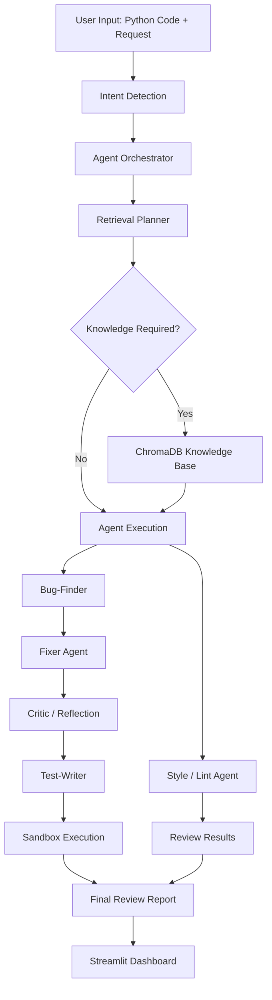

# Code Review & Debug Squad

**An AI-powered multi-agent system for automated Python code review, debugging, code improvement, and test generation.**

Code Review & Debug Squad is an intelligent code analysis application that simulates a collaborative software engineering team. Instead of relying on a single AI response, it uses specialized agents to inspect code, identify potential issues, suggest improvements, generate fixes, and validate them through automated testing.

Built with **Python, Streamlit, LangChain, Ollama, and ChromaDB**, the application combines multi-agent orchestration, local language models, static analysis, and Retrieval-Augmented Generation (RAG) into a unified code review workflow.

---

## Overview

Code Review & Debug Squad aims to make code reviews more systematic, explainable, and practical.

A submitted code snippet passes through a series of specialized analysis and validation stages. Each agent has a specific responsibility, and their results are combined into a consolidated review.

**Core capabilities:**

- Automated bug detection and debugging.
- Code quality and style analysis.
- AI-generated code corrections.
- Reflection-based review of proposed fixes.
- Automated unit test generation.
- Test execution in an isolated execution environment.
- Intent-based agent routing.
- Context-aware knowledge retrieval using RAG.
- Local LLM inference through Ollama.

## Architecture

The application follows a modular multi-agent architecture coordinated by a central orchestrator.



### Agent Responsibilities

| Agent | Responsibility |
|---|---|
| **Bug-Finder** | Detects logical errors, runtime risks, and edge cases. |
| **Style/Lint** | Evaluates readability, naming conventions, and coding standards. |
| **Fixer** | Generates corrected and improved code. |
| **Critic / Reflection** | Reviews proposed fixes and identifies potential shortcomings. |
| **Test-Writer** | Generates unit tests to validate code behavior. |
| **Explainer** | Explains code functionality and implementation logic. |
| **Intent Router** | Identifies the user's objective and selects the appropriate workflow. |
| **Retrieval Planner** | Determines whether external coding knowledge should be retrieved from the knowledge base. |

## Intelligent Workflow

The system uses intent detection to determine which workflow should execute.

| Intent | Purpose |
|---|---|
| `debug` | Identify bugs and generate corrections. |
| `style` | Review readability and coding conventions. |
| `explain` | Explain the submitted code. |
| `test` | Generate and execute unit tests. |
| `full_review` | Perform a comprehensive code review. |

The orchestrator coordinates the selected agents and combines their outputs into a unified result.

## Agentic RAG

The project integrates **Retrieval-Augmented Generation (RAG)** using ChromaDB to provide agents with relevant programming knowledge.

Rather than retrieving documents for every request, a Retrieval Planner first determines whether additional context is necessary.

When retrieval is required:

1. The planner generates a relevant search query.
2. ChromaDB searches the coding knowledge base.
3. Relevant guidelines and examples are retrieved.
4. Retrieved context is provided to the appropriate agents.
5. Agents use the additional knowledge during analysis and generation.

The knowledge base supports Markdown documents containing debugging examples, coding standards, and testing guidelines.

## Technology Stack

| Technology | Usage |
|---|---|
| Python | Application logic and backend |
| Streamlit | Interactive web interface |
| Ollama | Local LLM inference |
| Qwen 2.5 Coder | Primary code-focused model |
| Llama 3.2 | General-purpose model |
| Gemma 3 | Lightweight model option |
| LangChain | LLM integration and orchestration |
| LCEL | Prompt and model chain composition |
| ChromaDB | Vector storage and semantic retrieval |
| Python AST | Static code analysis |
| Pytest | Automated testing |

## Application Features

### 1. Multi-Agent Code Review
Specialized agents independently analyze different aspects of submitted code.

### 2. Automated Code Correction
The Fixer generates an improved implementation based on identified issues.

### 3. Reflection and Validation
A Critic evaluates the proposed correction before the testing stage.

### 4. Automated Test Generation
The Test-Writer creates test cases to evaluate the implementation.

### 5. Sandbox Execution
Generated tests are executed with timeouts and execution restrictions to reduce risks from untrusted code.

### 6. Interactive Dashboard
The Streamlit interface provides five sections:

- **Report:** Consolidated code review and identified issues.
- **Fixed Code:** Corrected implementation and code differences.
- **Tests:** Generated test cases and execution results.
- **Agent Trace:** Execution steps, routing decisions, and retrieval activity.
- **Prompts:** Agent prompt templates.

### 7. Local Model Execution
All language model inference is performed through locally hosted Ollama models. No cloud LLM API keys are required.

---

## Project Structure

```text
Code-Review-Debug-Squad/
│
├── app.py
├── conftest.py
├── requirements.txt
├── README.md
│
├── squad/
│   ├── config.py
│   ├── llm.py
│   ├── intent.py
│   ├── knowledge.py
│   ├── orchestrator.py
│   ├── prompts.py
│   ├── models.py
│   ├── analysis.py
│   ├── sandbox.py
│   └── report.py
│
├── knowledge_base/
│
├── tests/
│
├── .chroma/
│
└── .vscode/
```

---

## Getting Started

### Prerequisites

- Python 3.10 or later.
- [Ollama](https://ollama.com/) installed and running.
- Git.

### 1. Clone the repository

```bash
git clone https://github.com/Santhosh-M-08/Code-Review-Debug-Squad.git

cd Code-Review-Debug-Squad
```

### 2. Create a virtual environment

```bash
python -m venv .venv
```

Activate it:

**Windows (PowerShell)**

```powershell
.venv\Scripts\Activate.ps1
```

**Linux / macOS**

```bash
source .venv/bin/activate
```

### 3. Install dependencies

```bash
python -m pip install -r requirements.txt
```

### 4. Download local language models

Pull the supported models using Ollama:

```bash
ollama pull qwen2.5-coder:3b
ollama pull llama3.2:3b
ollama pull gemma3:1b
```

Verify the installed models:

```bash
ollama list
```

### 5. Start the application

```bash
python -m streamlit run app.py
```

Open the local URL displayed in the terminal to access the application.

### 6. Run the test suite

```bash
python -m pytest -q
```

---

## Example Usage

Submit a Python function such as:

```python
def find_max(numbers):
    maximum = numbers[0]

    for number in numbers:
        if number > maximum:
            maximum = number

    return maximum
```

Example request:

```text
Review this code for bugs, edge cases, and possible improvements.
```

The application can:

1. Detect potential edge-case failures, such as empty input.
2. Evaluate code readability and style.
3. Generate a corrected implementation.
4. Create unit tests for normal and edge-case inputs.
5. Execute tests and report the results.

---

## Design Principles

- **Modularity:** Each agent has a clearly defined responsibility.
- **Separation of Concerns:** UI, orchestration, prompts, retrieval, and execution are maintained separately.
- **Context Awareness:** Relevant coding knowledge is retrieved when necessary.
- **Validation:** Generated corrections are evaluated through automated testing.
- **Local-First:** Language models run locally through Ollama.
- **Transparency:** Agent traces help users understand the review workflow.

## Limitations

- The current implementation focuses on Python code.
- Results depend on the capabilities of the selected local language model.
- AI-generated fixes and tests may require human verification.
- Initial ChromaDB setup may require downloading an embedding model.
- The sandbox has execution restrictions but should not be considered a fully secure environment for arbitrary untrusted code.

## Future Improvements

- Support for additional programming languages.
- More advanced static analysis.
- Improved test coverage and automated repair.
- Stronger sandbox isolation.
- Additional local language models.
- Integration with GitHub pull requests and repository-level reviews.

---

## Project Goal

The goal of Code Review & Debug Squad is to demonstrate how multi-agent AI systems, local language models, prompt engineering, Retrieval-Augmented Generation, and automated testing can work together to create a practical software engineering assistant.

**Built with Python and local AI. Designed for smarter code reviews.**